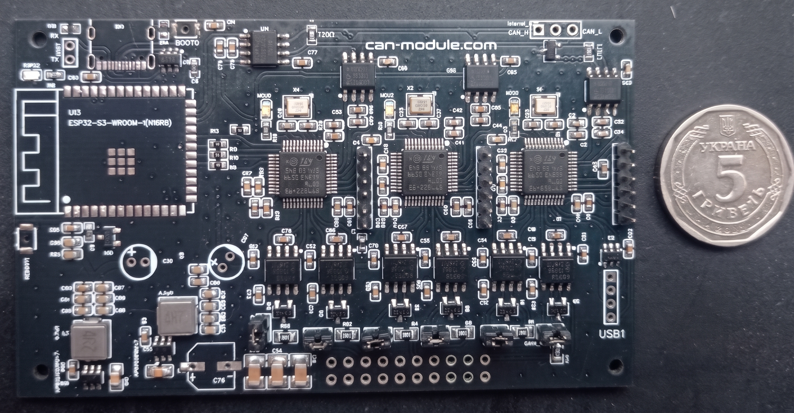

STM32G473CBT6

# MCU_1

FDCAN1  PB8  rx, PB9  tx -|

                          +-----> CAN bridge 1

FDCAN2  PB12 rx, PB13 tx -|

FDCAN3  PA8  rx, PA15 tx - internal can_bus

usb     PA11,PA12

led_status  PA3

# MCU_2 

FDCAN1  PA11  rx, PA12  tx-|

                           + ---> CAN bridge 2

FDCAN3  PA8  rx, PA15 tx  _|

FDCAN2  PB5 rx, PB6 tx  -- internal can_bus

led_status  PA3

# MCU_3

FDCAN1  PA11  rx, PA12  tx-|

                           + ---> CAN bridge 3

FDCAN3  PA8  rx, PA15 tx  _|

FDCAN2  PB5 rx, PB6 tx  -- internal can_bus

led_status  PA3

bus mcu3 <-> esp32s3

spi0 cs   PA4

spio sck  PA5

spi0 mosi PA6

spi0 miso PA7

---

# ESP32-S3 

CAN rx io47 , tx io48

spi mosi io11

spi sck  io12

spi miso io13

spi cs   io14

usb io19.io20

